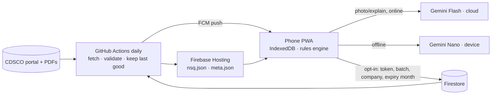

# DawaShield · दवा कवच

## Run it in one command

```bash
docker compose up
```

Then open **http://localhost:3000**. No API keys are needed for the core flow: the main screen, typed and demo checks, the RED / AMBER / GREY results with their CDSCO source line, the cabinet, Hindi and English, and the offline rule-based check all work without keys. Cloud AI and push need a setup key, and the app shows a calm "key not set" note where that matters.

Round 2 pitch deck: [docs/DawaShield_Pitch_Deck.pdf](docs/DawaShield_Pitch_Deck.pdf)

Optional live site (the hosted version, not needed to run this repo): https://dawashield-hybrid-3023.web.app

Built by Neeraj Kumar for the Scaler x Wispr Flow "India Runs on Voice" hackathon, Round 2. All build prompts were dictated with Wispr Flow.

This repository has the full git history from 15 Nov 2026, the start of the hackathon.

**A medicine companion for every Indian home.** Speak in Hindi or English (offline), or Punjabi, Gujarati, Marathi, Kannada or Tamil (online), type, or show a photo of a medicine strip, and DawaShield checks your family's medicines against official **CDSCO** drug-quality alerts (NSQ = Not of Standard Quality, and spurious). The check **works without internet, on cheap Android phones**.

> Your mother's medicine cabinet shouldn't need an internet connection, English literacy or a technical understanding of batch numbers to stay informed about medicine safety.

Entry for Google's **#BuildHybridAI 2026** hackathon. Live: **https://dawashield-hybrid-3023.web.app**

## Demo video

**Watch the demo:** https://youtu.be/Ajm1V1TYdz4 — a short walkthrough of the voice, photo and typed checks against the official CDSCO list.

Built by Neeraj Kumar.

---

## The problem

CDSCO, India's drug regulator, and the state drug labs publish lists of medicine batches that failed quality tests or were found to be fake. They come out about a month late, as PDFs and tables on a government website, in English, organised by batch number. The people most at risk (elderly parents managing five strips a day, families in small towns, anyone who reads Hindi more easily than English) are the least likely to ever see them.

## Features

| | Feature | How |
|---|---|---|
| 1 | **Voice check (Hindi / English)** | Say the medicine name. Garbled speech-to-text is matched **offline** with Hindi-aware phonetic + fuzzy matching against a 2,600+ name dictionary; pick from 2–4 big buttons |
| 2 | **Photo check** | Auto-crop, grayscale, glare reduction, CLAHE contrast boost, sharpen → two AI reads → per-field confidence; low confidence = "please confirm"; very low = "Can't read clearly" (keypad or retake, never a guess). Second photo merges fields. Big-button batch keypad always one tap away |
| 3 | **Works offline on any phone** | Installable PWA; full dataset in IndexedDB (~0.5 MB download); matching is pure rule-based code. Gemini Nano / Flash are extras, with capability detection and fallback |
| 4 | **Honest, sourced results** | RED / AMBER / GREY with CDSCO alert month, official link and record ID on every answer; "Verified" badge on hand-checked records; "Official data checked up to" + "Last updated" |
| 5 | **Company entity resolution** | Normalised names, alias table, token-set similarity with a confidence score |
| 6 | **Home medicine cabinet** | Saved medicines are re-checked **daily**; opt-in **web push** even when the app is closed (flagged batches + expiry ~5 days before); calendar (.ics) fallback |
| 7 | **Family alerts** | WhatsApp message, or optional push to a family member's phone after they accept an invite link |
| 8 | **Report it** | Pre-filled CDSCO complaint (email, toll-free) and PvPI; "Report a wrong result" (no personal data) |
| 9 | **Try a demo** | Real RED batches 251TTF014, P03524, 054A003 from the official list |
| 10 | **Hindi + English everywhere** | Pre-written templates for every result type, pre-recorded Sarvam AI voice clips; works offline |
| 11 | **5 regional languages (online)** | Punjabi, Gujarati, Marathi, Kannada, Tamil: build-time Sarvam translation with back-translation review; native-script picker with a "Needs internet" badge; offline falls back to Hindi |
| 12 | **Transparency page** | Records, latest alert month, last refresh, hand-verified count, tests passed, false-RED / false-GREY, confusion table, known limits |

## Safety rules (non-negotiable)

- **The colour is decided by plain, tested code** ([`src/lib/match.ts`](src/lib/match.ts)), never by AI.

| Input | Result |
|---|---|
| Exact batch **and** company matched with high confidence (or the medicine name, when the record names no company, as with spurious drugs) | **RED** · NSQ or SPURIOUS shown |
| Exact batch, company uncertain / different / medicine name differs | **AMBER — possible match** |
| Batch one character off, OCR look-alike (0/O, 1/I/L, 5/S, 8/B, 2/Z) or incomplete, for a related medicine or company | **AMBER — possible match** |
| Same company **and** same medicine, different batch | **AMBER — other batches flagged** |
| Same company, **different** medicine | **GREY** + small note: *"This company has a different medicine on the official list (<medicine>, <month>). This alert is for a different medicine, not your batch."* Record behind "See details"; no family-alert or report buttons |
| No record | **GREY**: *"No official alert for this exact batch. This does not prove the medicine is safe. Official alerts can be delayed."* |
| Photo/voice too unclear (photo batch confidence < 0.45, or spoken batch < 3 characters / no digit) | **CAN'T READ CLEARLY**: keypad or retake; never shown as GREY |

**Real example (regression test `tests/decision-table.test.ts`).** Dolo-650 by Micro Labs, batch DOBS4518, is *not* on the list. A different Micro Labs medicine, Amlodipine, batch AMAS0249, *is*. The old engine showed AMBER ("company has official action"), which frightened people about a medicine that was never flagged. It now shows GREY with the small note above.

**NSQ vs spurious.** NSQ (Not of Standard Quality) means a lab found a batch failed a quality test. Spurious means the product is fake or falsely labelled. RED always names which one. Spurious adds: *"Keep the strip and the bill. Don't use it. Report it to the chemist and CDSCO."*

**RED wording:** *"An official alert matches this exact batch. Talk to your doctor or chemist before your next dose. Don't stop an essential medicine on your own."* Every result has a large **"What should I do?"** card; the spoken reply starts with the colour and one sentence. Next to the headline: *"Official data checked up to <month>"* and *"Next update expected: <date>"* (end of the third month after the latest alert month, the usual CDSCO lag; tomorrow if that date has passed). The official link opens the exact monthly CDSCO PDF when its URL is known (only `https://cdsco.gov.in/` links are trusted), otherwise the CDSCO alerts page.

- **Never recommends any medicine**, dose or treatment, and never any alternative medicine.
- DawaShield is an information tool, not a certificate or medical advice. Counterfeits can copy real batch numbers, so GREY cannot rule them out. This line appears on Home, every result, First run, How it works and Transparency.
- Every safety message is pre-written in Hindi and English ([`src/content/messages.ts`](src/content/messages.ts), [`src/content/templates.ts`](src/content/templates.ts)).

## How it works

Full details and diagrams: **[docs/ARCHITECTURE.md](docs/ARCHITECTURE.md)**: data pipeline, hybrid AI router, offline matching engine, entity resolution, push re-check loop, privacy design.



| Task | Where |
|---|---|
| Speech → medicine name | Web Speech API + **offline phonetic matcher**; Nano/Flash add candidates when available |
| Strip photo → fields | Preprocessing on device → **Gemini Flash** (cloud) online, **Gemini Nano** offline |
| Match batch / company | **Plain code on device** |
| Explanation | **Pre-written Hindi/English templates (offline)**; Flash for more detail online |
| New data, re-check, push | GitHub Actions (free), Firebase Admin SDK, FCM |

Every AI answer shows **"On this device"** or **"Cloud"**, taken from the SDK's `inferenceSource`.

## Data source

- **Official CDSCO only:** the public NSQ/spurious alert portal ([cdscoonline.gov.in/CDSCO/viewPublicNSQDrug](https://cdscoonline.gov.in/CDSCO/viewPublicNSQDrug)) and monthly alert PDFs on [cdsco.gov.in](https://cdsco.gov.in/opencms/opencms/en/Notifications/Alerts/).
- **Coverage:** **4,488 records** (4,438 NSQ, 50 spurious), alert months **October 2024 to October 2026** (fixed start, end moves forward; historical records are never dropped without a documented correction in [`data/corrections.json`](data/corrections.json)); **55 checked by hand** ([`data/verified_records.csv`](data/verified_records.csv)). Reconciliation of the October 2026 import: [`docs/RECONCILIATION.md`](docs/RECONCILIATION.md).
- **Daily pipeline** ([`.github/workflows/dataset.yml`](.github/workflows/dataset.yml)): fetch → parse → normalise → dedupe → **validate** ([`data/validate.py`](data/validate.py)). If the source is down or the parse looks wrong (sharp record drop, missing fields, month going backwards), the last good data is kept and the failure is logged in [`data/pipeline_log.json`](data/pipeline_log.json). Added records are listed in [`data/CHANGELOG.md`](data/CHANGELOG.md).

## Evaluation

`npm run eval` → **[docs/EVAL.md](docs/EVAL.md)**, also in the app under "Transparency".

| | Result |
|---|---|
| **Full population (ground truth: the CDSCO records themselves):** the 4,477 records with a printed batch, each run with its own batch, medicine and company | **4,477 / 4,477 shown RED** |
| Records with no printed batch ("Not Mention", "NIL", …): 11, excluded from the exact test | **0 shown RED** (10 AMBER, 1 GREY); a placeholder batch can never produce an exact-batch RED |
| **Negative control (ground truth: dataset):** 2,000 seeded batches that appear nowhere in the dataset, unlisted companies | **2,000 / 2,000 shown GREY** (seed 20261125) |
| Stress set, **author-labelled** robustness testing: 728 cases (106 real, 622 generated from the author's 55 hand-verified records), spelling, spacing, OCR look-alikes, wrong company, same company/other medicine, unreadable | False-RED 0.0% (0/489) · False-GREY 0.0% (0/619) |
| Stress set confusion (rows expected, columns shown) | RED 239/0/0/0 · AMBER 0/325/0/0 · GREY 0/0/109/0 · CAN'T READ 0/0/0/55 |
| Hindi/English speech, 60 garbled transcripts | Top-1 98.3% · Top-3 100% |
| Punjabi, Gujarati, Marathi, Kannada, Tamil: 24 **generated** garbled transcripts each | Top-1 100% · Top-3 100% (generated, not real speakers) |
| Photo (`data/eval_images/labels.csv`; add with `npm run add-photo`) | No labelled photos yet: not measured |
| Privacy: what is stored and what is sent to cloud AI | [`docs/PRIVACY.md`](docs/PRIVACY.md) |
| Push alerts with the app fully closed | **NOT VERIFIED** on real devices (unit and logic checks only) |
| Cloud Gemini explanation and strip-photo reading | **Verified on a real iPhone** (mobile data, 25 Nov 2026). The automated laptop retest is pending. See [`docs/HYBRID-AI.md`](docs/HYBRID-AI.md) |
| On-device Gemini Nano photo reading | **Not verified.** One desktop Chrome attempt showed "On this device" but returned 0% confidence fields |
| Unit tests | 250 app tests passing; 20 pipeline tests passing (`python -I -m unittest discover -s data -p "test_*.py"`) |

## Real-World Voice Validation

DawaShield was tested by four family members on their own phones, using live voice in Hindi, English and Punjabi. One participant was aged 60+.

- Participants: 4
- Successful medicine batch checks: 4/4
- Task completion rate: 100%
- Manual typing required: None
- Developer assistance required: None

This was an initial, informal test, observed by the builder. It shows that an end-to-end, voice-first medicine batch check is feasible. Larger testing with wider language and accent coverage is planned.

## What works where

| Capability | Where |
|---|---|
| Batch / company matching, full official list, result text, Hindi + English voice clips | **Offline, any phone browser** (after the first visit) |
| Hindi / English speech input | Chrome / Android; offline only if the browser's Hindi speech pack is installed |
| Punjabi, Gujarati, Marathi, Kannada, Tamil | **Online only**; offline falls back to Hindi with a banner and switches back automatically. Mic hidden where the browser cannot recognise that language |
| Photo reading on a phone | **Needs internet** (Gemini Flash via Firebase AI Logic) |
| Offline photo reading, Gemini Nano | **Only supported desktop Chrome** |
| Push alerts | Android / desktop browsers; **iPhone only when added to the home screen** |

## Limits (honest)

- **Grey is not safe.** CDSCO lists come out about a month late, not every state reports every month, most batches are never tested, and counterfeits can copy a real batch number.
- **Not yet proven:** accuracy on real strip photos (no labelled photos yet), and with real regional-language speakers. Not yet tested beyond 4 family members.
- Matching cases are real records plus generated variants; generated cases are labelled as such.
- Regional languages need internet. **The Punjabi, Gujarati, Marathi, Kannada and Tamil translations were written by Claude (AI) and back-translated by the same model**, then held to the plain-code meaning check (all 139 safety strings pass in every language). Because the back-translation is not independent, **review by native speakers is recommended**. Sheets: `i18n/manual/*.tsv`, `i18n/review/*.csv`.
- Regional voice uses the browser's built-in speech in that language only. If the device has no voice for it, the app shows text only with a small note, never a wrong-language voice. Hindi and English keep their recorded Sarvam clips.
- Gemini Nano only runs on supported desktop Chrome; on phones, photo reading needs the internet. Offline voice input needs the browser's Hindi speech pack. **The match itself always works offline.**
- Push needs a browser that supports web push; on iPhone only when installed to the home screen. The calendar file is the fallback.
- New data reaches the live site daily only when the `FIREBASE_SERVICE_ACCOUNT` secret is set in GitHub.

## Privacy

Voice is never stored: Hindi/English speech is turned into text by the browser; in the regional languages (or when browser recognition is unavailable) a clip of at most 8 s is sent once to Gemini via Firebase AI Logic + App Check, only to be transcribed. Photos are never stored. The cabinet and family numbers stay in the phone's IndexedDB. **Only if you opt in to push**, Firestore keeps a push token, language, and per saved medicine the batch number, company and expiry month: no medicine names, person names, phone numbers or health information. Firestore rules ([`firestore.rules`](firestore.rules)) let each anonymous device read/write only its own documents. No ads, no analytics.

## Run it

```bash
npm install
npm test               # Vitest unit tests
npm run test:data      # pipeline validation tests (Python)
npm run eval           # evaluation harness -> docs/EVAL.md
npm run build && npm run preview
npm run data           # rebuild public/data from CDSCO (Python 3.12 + pdfplumber)
npm run audio          # regenerate Hindi/English Sarvam voice clips (SARVAM_API_KEY in .env)
npm run i18n           # build-time regional translations + voice (SARVAM_API_KEY in .env; CACHE_ONLY=1 to rebuild from cache)
npm run add-photo -- strip.jpg "Dolo 650" DOBS4518 "11/2027" "Micro Labs"   # add a labelled eval photo
```

Firebase project `dawashield-hybrid-3023` (free Spark plan): Hosting, Firestore, anonymous Auth, Cloud Messaging, Firebase AI Logic with App Check (reCAPTCHA Enterprise key in `VITE_RECAPTCHA_SITE_KEY`). For the daily deploy + push, add a service-account key as the GitHub secret `FIREBASE_SERVICE_ACCOUNT`.

## Credits

Built by Neeraj Kumar. Data: Central Drugs Standard Control Organisation (CDSCO), Government of India. Voices and regional translations: Sarvam AI. MIT licence.

*DawaShield does not replace a pharmacist, doctor or official advice.*
