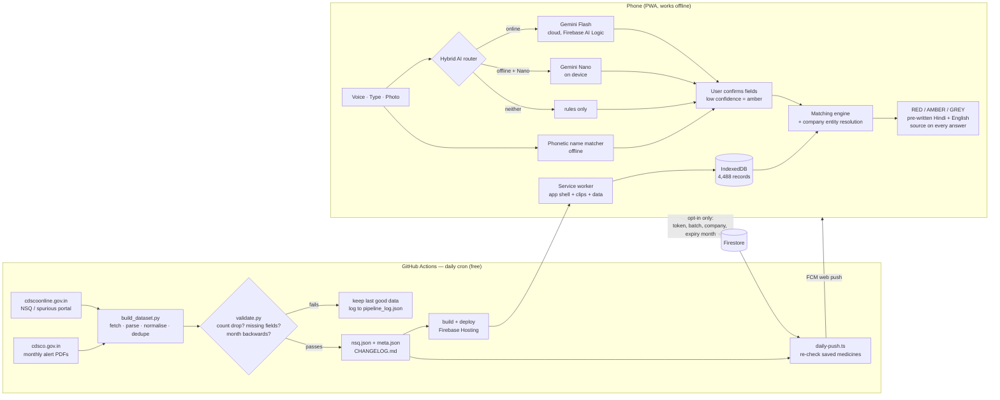
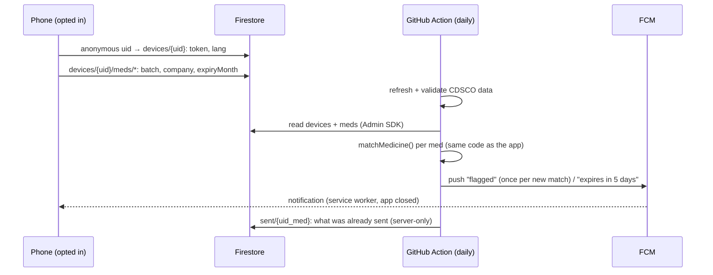

# DawaShield architecture

DawaShield checks medicines at home against official CDSCO "Not of Standard Quality" (NSQ) and spurious-drug alerts. **The colour of every answer is decided by plain, rule-based code on the phone. AI only helps people type less (speech, photo) and explain more.**

## Big picture

## 1. Data pipeline (`data/build_dataset.py`, `data/validate.py`, `.github/workflows/dataset.yml`)

- Runs **every day at 07:00 IST** on GitHub Actions (free). CDSCO publishes alerts about a month late at no fixed date, so a daily check gets new records out as soon as CDSCO does.
- Sources: the CDSCO public NSQ/spurious portal (structured rows) and the monthly alert PDFs (text used to cross-check rows; `pdfMatch`).
- Normalise batch (`B.No: 45A-2` → `45A2`), company names, dedupe repeated listings (`listedTimes`), mark the 55 hand-verified records (`data/verified_records.csv`) as `verified`.
- **Validation gate** (`validate.py`, unit-tested): no records, >10% drop in record count, >1% rows missing required fields, unknown type, malformed month, duplicate ids, or the latest month going backwards → **the new data is not published**; the last good version stays live and the reason is appended to `data/pipeline_log.json`.
- On success: `public/data/nsq.json`, `meta.json` (with `latestMonth`, `lastChecked`, sizes) and a `data/CHANGELOG.md` entry listing every added record; then build + deploy to Firebase Hosting.

## 2. Hybrid AI router (`src/lib/ai.ts`)

| Task | First choice | Fallback | Why |
|---|---|---|---|
| Read strip photo | **Gemini Flash (cloud)** when online | Gemini Nano on device | Small sideways print needs the stronger model; two independent reads are compared. Offline, Nano keeps it working on supported devices. |
| Understand speech | **Phonetic matcher (rules, offline)** | + Nano/Flash candidates when available | Works on any phone with no model; AI only adds candidates. |
| Explain a record | **Pre-written templates (offline, Hindi + English)** | Flash for a richer explanation / follow-up chat when online | Nano cannot write Hindi; templates are always correct and safe. |
| Decide the colour | **Never AI** — matching engine | — | Safety. |

Every AI answer carries the SDK's real `inferenceSource`, shown as **"On this device"** or **"Cloud"** (never "Unknown"). Capability is detected at runtime (`LanguageModel.availability`), and the result screen's "How this answer was made" lists every AI call with source and time.

## 3. Photo pipeline (`src/lib/enhance.ts`, `src/lib/image.ts`, `src/lib/label.ts`)

1. **Auto-crop** to the printed area (edge-energy projection on a small preview).
2. **Enhance** for small/shiny text: grayscale → **glare reduction** (blown highlights pulled to the local mean via an integral image) → **CLAHE** (8×8 tiles, clip limit, bilinear blend) → **unsharp-mask sharpen**.
3. Full read twice (cloud) + zoomed enhanced crop of the B.No/EXP box when small; one more enhanced read if batch/expiry is still unsure.
4. Plain-code checks: keyword-anchored batch (must come after B.No/Batch/Lot), **licence numbers and MFD never accepted as batch/expiry**, expiry must be after MFD.
5. Every field gets a **confidence score** (model score lowered by any failed check). Below 0.75 → amber "please confirm" with the editable field highlighted. A second photo can be merged field by field. A big-button keypad is always one tap away.

## 4. Offline matching engine (`src/lib/match.ts`)

- The full dataset (~0.5 MB gzip) is stored in **IndexedDB**; the service worker precaches the app shell, data and Hindi/English voice clips (regional files are excluded) (~2.7 MB transferred in total).
- Pure TypeScript rules, a few milliseconds per check on 4,488 records; no AI, no WASM, so it runs in any low-end Android browser.

| Input | Result |
|---|---|
| Exact batch **and** company matched with high confidence (or the medicine name, when the record names no company, as with spurious drugs) | **RED** · NSQ or SPURIOUS shown |
| Exact batch, company uncertain / different / medicine name differs | **AMBER — possible match** |
| Batch one character off, OCR look-alike (0/O, 1/I/L, 5/S, 8/B, 2/Z) or incomplete, for a related medicine or company | **AMBER — possible match** |
| Same company **and** same medicine, different batch | **AMBER — other batches flagged** |
| Same company, **different** medicine | **GREY** + small note: *"This company has a different medicine on the official list (<medicine>, <month>). This alert is for a different medicine, not your batch."* Record behind "See details"; no family-alert or report buttons |
| No record | **GREY**: *"No official alert for this exact batch. This does not prove the medicine is safe. Official alerts can be delayed."* |
| Photo/voice too unclear (photo batch confidence < 0.45, or spoken batch < 3 characters / no digit) | **CAN'T READ CLEARLY**: keypad or retake; never shown as GREY |

**Real example (regression test `tests/decision-table.test.ts`).** Dolo-650 by Micro Labs, batch DOBS4518, is *not* on the list. A different Micro Labs medicine, Amlodipine, batch AMAS0249, *is*. The old engine showed AMBER ("company has official action"), which frightened people about a medicine that was never flagged. It now shows GREY with the small note above.

**NSQ vs spurious.** NSQ (Not of Standard Quality) means a lab found a batch failed a quality test. Spurious means the product is fake or falsely labelled. RED always names which one. Spurious adds: *"Keep the strip and the bill. Don't use it. Report it to the chemist and CDSCO."*

**RED wording:** *"An official alert matches this exact batch. Talk to your doctor or chemist before your next dose. Don't stop an essential medicine on your own."* Every result has a large **"What should I do?"** card; the spoken reply starts with the colour and one sentence. Next to the headline: *"Official data checked up to <month>"* and *"Next update expected: <date>"* (end of the third month after the latest alert month, the usual CDSCO lag; tomorrow if that date has passed). The official link opens the exact monthly CDSCO PDF when its URL is known (only `https://cdsco.gov.in/` links are trusted), otherwise the CDSCO alerts page.

## 5. Company entity resolution (`src/lib/entity.ts`)

1. Normalise: drop address, `M/s`, `Pvt/Private/Ltd/Limited/LLP/Inc/Co/India`, punctuation; standardise spelling (`Pharmaceuticals/Pharmaceutical/Pharma` → `PHARMA`, `Laboratories` → `LABS`, `Life Sciences` → `LIFESCIENCES`…).
2. Alias table for well-known short forms (GSK, Cadila Healthcare → Zydus Lifesciences, Dr. Reddy's…).
3. **Token-set ratio** (Indel/LCS ratio, as in fuzzywuzzy/rapidfuzz) with typo-tolerant token alignment, plus guards: must share a *distinctive* word (sharing only "Pharma" is not a match); extra distinctive words or a different company type cap confidence.
4. Bands: exact (1.0) · high (≥0.90) · medium (≥0.72) · low.

## 6. Hindi voice (`src/lib/phonetic.ts`)

- Dictionary: every record's brand/generic name + ~370 common Indian brands/generics (2,600+ entries), each with a Devanagari transliteration and phonetic keys.
- Transcript → Latin (Devanagari transliteration) → candidate words and joined neighbours (STT splits names) → **Hindi-aware metaphone-style key** (ph=f, kh=k, bh=b, z=j, soft c/g, vowels dropped after the first) → score = edit-distance similarity on key (60%) + spelling (40%), weighted by how much of the utterance it explains. Top 2–4 shown as big buttons.
- Fixed messages are pre-recorded Sarvam AI (Bulbul) clips in Hindi and English; medicine names are shown on screen, not spoken.

## Regional languages (online only)

- **Build time only.** `npm run i18n` (`scripts/i18n-build.ts`) collects every UI string and result template (`scripts/i18n-strings.ts`, 579 strings, 139 safety strings). Translations come from the Sarvam cache (Punjabi, partial) and from `i18n/manual/<lang>.tsv`, which holds a translation and an English back-translation for each string, both AI-assisted. Plain code compares meaning (word overlap + negation check, placeholders kept). A safety string that drifts uses its retranslation (`index!` line); if that still drifts it is **flagged and shown in English**. Current result: all 5 languages 579/579, 0 flagged. Native-speaker review recommended. Sarvam (`sarvam-translate:v1` / `mayura:v1`) stays as an optional upgrade path when `SARVAM_API_KEY` is set.
- The Sarvam key lives only in `.env` on the build machine. The browser never calls Sarvam or any translation service; it fetches static `public/i18n/<lang>.json`.
- A language is offered in the picker only when `public/i18n/index.json` marks it available (≥90% of strings and ≥90% of safety strings verified). Others show "Translation in review".
- Medicine names, batch numbers, companies and dates are never translated (`translate="no"`); names get a transliteration in the chosen script (`src/lib/indic.ts`).
- Speech (any phone, incl. iPhone): the app records a short clip with `MediaRecorder` (`src/lib/recorder.ts`; webm/opus on Chrome, audio/mp4 on iOS Safari; max 8 s / 1.5 MB) and sends it once to **Gemini Flash-Lite through Firebase AI Logic + App Check** with a transcription-only prompt (`transcribeAudio` in `src/lib/ai.ts`, Flash as fallback). The transcript is mapped to Devanagari by Unicode block offset and matched by the same deterministic phonetic matcher; the user picks from 2–4 big buttons. AI only transcribes; it never chooses a medicine or a colour. Hindi / English use browser recognition and switch to this recording path when Web Speech is missing or fails (`browserFailed` in `src/lib/speech.ts`). Offline: a polite "type or use a photo" card.
- Voice: the browser's `speechSynthesis` reads the reviewed translated text, only with a voice whose language matches (`pickVoice` in `src/lib/audio.ts`); no match = text only with a small note. Pre-generated **Gemini TTS** clips (`npm run audio:gemini`, build time, key from `.env`, never in the client) are played when `index.json` says `voice: "gemini"`; each language first passes a round-trip check (TTS → Gemini transcript → character similarity ≥ 0.8). A clip that is missing falls back to the device voice, then text only. Clips are 32 kbps mono mp3, fetched only when played. `i18n/**` and regional audio are excluded from the precache, so **the offline download does not grow**.

## 7. Push re-check loop (`scripts/daily-push.ts`, `src/lib/pushplan.ts`)

Family: the owner creates `invites/{random code}`; the family member opens the link, accepts, and adds only their own push token under it. Flagged alerts go to both. Users who don't allow push get **"Add expiry to my calendar"** (.ics with an alarm 5 days before expiry).

## What works where

| Capability | Where |
|---|---|
| Batch / company matching, full official list, result text, Hindi + English voice clips | **Offline, any phone browser** (after the first visit) |
| Hindi / English speech input | Chrome / Android; offline only if the browser's Hindi speech pack is installed |
| Punjabi, Gujarati, Marathi, Kannada, Tamil | **Online only**; offline falls back to Hindi with a banner and switches back automatically. Mic hidden where the browser cannot recognise that language |
| Photo reading on a phone | **Needs internet** (Gemini Flash via Firebase AI Logic) |
| Offline photo reading, Gemini Nano | **Only supported desktop Chrome** |
| Push alerts | Android / desktop browsers; **iPhone only when added to the home screen** |

## 8. Privacy design

- Default: **nothing leaves the phone**. Cabinet and family numbers live in IndexedDB.
- Push is **opt-in** with a clear consent text. Stored in Firestore only: push token, language, batch number, company name, expiry month. **No medicine names, person names, phone numbers or health information.** Turning it off deletes the documents.
- Identity is an **anonymous Firebase Auth uid**. Firestore rules (`firestore.rules`) let each device read/write only its own docs, with field allow-lists and size limits; `sent/` is server-only; `reports/` is write-only.
- Voice: in Hindi/English with browser recognition nothing is recorded; in the regional languages (or when browser recognition is unavailable) a clip of at most 8 s is sent once to Gemini for a transcript and never stored. Photos are never stored. AI calls send only the photo being read, or the official record + the user's question.
- App Check (reCAPTCHA Enterprise) protects the Firebase AI Logic endpoint.
- Everything runs on the free Spark plan: Hosting, Firestore, Auth, FCM; scheduled work on GitHub Actions (no Cloud Functions).
